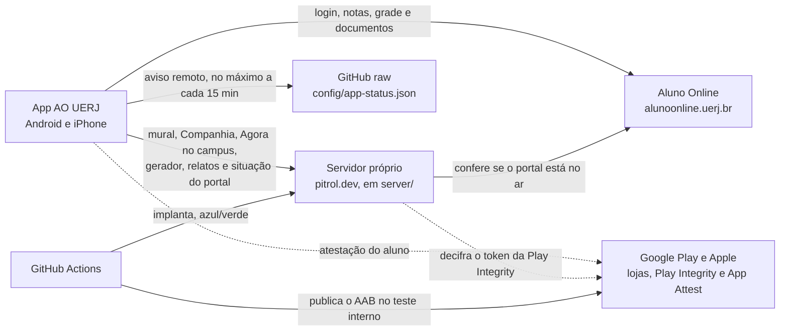

<div align="center">


# AO UERJ

**O Aluno Online da UERJ no seu celular, com o que o portal não tem.**

App de código aberto, feito por aluno para aluno: notas, grade, documentos e ferramentas para planejar o curso, até sem internet.

[](https://play.google.com/store/apps/details?id=com.aouerjmobile)
[](LICENSE)
[](https://github.com/pitroldev/ao-uerj-mobile-ts/actions/workflows/quality.yml)
[](https://github.com/pitroldev/ao-uerj-mobile-ts/actions/workflows/server.yml)
[](https://github.com/pitroldev/ao-uerj-mobile-ts/actions/workflows/ios.yml)
<br>
[](https://play.google.com/store/apps/details?id=com.aouerjmobile)
[](docs/ios.md)
[](https://reactnative.dev)
[](https://www.typescriptlang.org)

[Baixar na Play](https://play.google.com/store/apps/details?id=com.aouerjmobile) · [Contribuir](CONTRIBUTING.md) · [Documentação](docs/README.md) · [Privacidade](docs/privacidade.md)

</div>

> [!NOTE]
> O AO UERJ é um app **não oficial**, sem vínculo com a UERJ. Ele usa a sua conta do Aluno Online, direto do seu celular.

## O que o app faz

O app está publicado para Android. O código do iPhone existe e compila no CI, mas ainda não está na App Store: a coluna do iPhone mostra o que esse código já faz.

|     | Funcionalidade         | O que faz                                                                                             | Android |              iPhone               |
| :-: | ---------------------- | ----------------------------------------------------------------------------------------------------- | :-----: | :-------------------------------: |
| 🏠  | **Início**             | A próxima aula e a sala, a semana, as notas e as próximas provas numa tela só, do seu jeito           |   ✅    |                ✅                 |
| 📝  | **Notas e PF**         | Quanto falta na PF de cada disciplina e a simulação do CR aproximado                                  |   ✅    |                ✅                 |
| 🙋  | **Faltas**             | Você marca as faltas e vê quanto ainda pode faltar (fica só no aparelho)                              |   ✅    |                ✅                 |
| 📌  | **Provas e trabalhos** | As datas anotadas aparecem no Início, na semana e nas notas, com lembretes                            |   ✅    |                ✅                 |
| 🎓  | **Meu Progresso**      | O avanço no currículo, as horas complementares e o plano até a formatura                              |   ✅    |                ✅                 |
| 📚  | **Consultas do AO**    | Histórico, currículo, disciplinas universais, pesquisa de disciplinas e RID                           |   ✅    |                ✅                 |
| 📄  | **Documentos**         | Emite e compartilha os PDFs do portal e guarda até 5 no aparelho                                      |   ✅    |                ✅                 |
| 🧩  | **Gerador de grades**  | Monta grades com os horários livres e o almoço que você escolher e manda a melhor para a turma        |   ✅    |                ✅                 |
| 💬  | **Mural da turma**     | Mensagens por turma, com o nome que você escolher                                                     |   ✅    |                ✅                 |
| 🍽️  | **Companhia agora**    | Uma mesa para almoçar junto ou um grupo para voltar depois da aula da noite                           |   ✅    |        ✅ sem o "Me avise"        |
| 📢  | **Agora no campus**    | Avisos dos alunos: elevador parado, fila do bandejão, sala trancada                                   |   ✅    | ✅ sem os avisos em segundo plano |
| 🗺️  | **Mapa do campus**     | O campus e o Pavilhão andar por andar, com as salas, sem internet                                     |   ✅    |                ✅                 |
| 🔔  | **Lembretes e avisos** | Lembrete de aula e de prova; aviso de nota nova, RID, inscrição, documento vencendo e portal de volta |   ✅    |      ✅ quando o iOS deixar       |
| 📱  | **Widgets e atalhos**  | "Próxima aula" e "Hoje" na tela inicial e atalhos no ícone                                            |   ✅    |             ✅ e Siri             |
| 📶  | **Sem internet**       | Abre na hora com os dados salvos, cifrados no aparelho, e avisa quando o portal cai                   |   ✅    |                ✅                 |
| 🌙  | **Tema escuro**        | Claro, escuro ou o do sistema                                                                         |   ✅    |                ✅                 |

Como cada uma funciona por dentro está em [Funcionalidades](docs/funcionalidades.md).

## Por que contribuir

- 🎯 **Você resolve o seu próprio problema.** Sentiu falta de algo no Aluno Online? Dá para fazer aqui, e os seus colegas usam.
- 🛠️ **Stack de mercado.** React Native 0.88 (nova arquitetura e React Compiler), React 19.3, TypeScript 7, Kotlin, Swift e um backend em Node com MongoDB.
- 🏗️ **Projeto de verdade.** Arquitetura hexagonal, testes, CI/CD, publicação na Play e implantação azul/verde. Bom para aprender e para o portfólio.
- 🤝 **Tem lugar para todo tamanho de ajuda.** Um texto mais claro, um teste, um parser, uma tela nova ou um relato de bug bem feito.

## Comece em 5 passos

> [!TIP]
> No Windows, use o Git Bash. O passo a passo completo, com os pré-requisitos de cada sistema, está no [guia de contribuição](CONTRIBUTING.md#preparar-o-ambiente).

1. **Instale o básico:** Git, Node 22.21.1 (`.node-version`), JDK 17 e o Android Studio (SDK 37, Build Tools 37.0.0, NDK 27.1.12297006 e um emulador).
2. **Faça um fork e clone:**
   ```sh
   git clone https://github.com/<seu-usuário>/ao-uerj-mobile-ts.git
   cd ao-uerj-mobile-ts
   ```
3. **Instale as dependências** (o app, o servidor e os hooks do Git):
   ```sh
   npm install -g corepack@latest
   corepack enable
   pnpm install --frozen-lockfile
   ```
4. **Rode no Android**, com o emulador aberto:
   ```sh
   pnpm start      # o Metro, num terminal
   pnpm android    # em outro: compila, instala e abre
   ```
   Entre com a sua própria conta do Aluno Online: o app lê o portal real, sem conta de demonstração.
5. **Opcional, o servidor:** os testes não precisam de banco instalado (baixam um mongod próprio na primeira vez).
   ```sh
   pnpm test:server
   pnpm server dev   # precisa de server/.env com um MONGODB_URI
   ```

Antes de abrir o PR: `pnpm lint`, `pnpm format:check`, `pnpm type-check`, `pnpm knip`, `pnpm test:ci` e `pnpm test:tooling`. O que cada um confere está em [Desenvolvimento](docs/desenvolvimento.md#verificações).

## Como as peças conversam



- A senha e os dados do portal só vão do celular para o Aluno Online. O servidor próprio recebe a matrícula e o nome, para identificar o aluno nas funções entre alunos.
- O [aviso remoto](docs/aviso-remoto.md) liga avisos e desliga telas sem nova versão.
- Os detalhes estão em [Arquitetura](docs/arquitetura.md) e em [server/README.md](server/README.md).

## Mapa do projeto

```text
ao-uerj-mobile-ts/
├── src/                o app em React Native e TypeScript
│   ├── pages/          as telas do menu
│   ├── features/       os blocos das telas (quadro de notas, folhas, Início)
│   ├── modules/        domínio, casos de uso e apresentação, um módulo por assunto
│   ├── adapters/       o Aluno Online, o servidor próprio, o armazenamento e o nativo
│   ├── components/ui/  o design system "Agenda limpa"
│   └── app/            composição, provedores e tarefas em segundo plano
├── android/            o projeto Android (cofre, avisos, widgets e atalhos em Kotlin)
├── ios/                o projeto iOS (Swift e Objective-C++), fora da App Store
├── server/             o backend de pitrol.dev (Node, Express e MongoDB)
├── deploy/server/      os scripts da implantação azul/verde na VM
├── config/             o aviso remoto (app-status.json) e o esquema dele
├── scripts/            Gradle, diagnósticos, ícones, mapa do campus e ferramentas de dev e de CI
├── .maestro/           os fluxos E2E do Maestro (manuais, com conta real)
├── docs/               a documentação
└── .github/            workflows, Renovate e modelos de issue e de PR
```

## Como contribuir

1. Escolha uma [issue](https://github.com/pitroldev/ao-uerj-mobile-ts/issues) (as marcadas com `good first issue` são um bom começo) ou abra uma contando o que quer fazer.
2. Crie um branch a partir da `main` no seu fork e faça a mudança, com testes.
3. Rode as verificações e abra o PR para a `main` deste repositório.

O [guia de contribuição](CONTRIBUTING.md) explica o ambiente, as convenções de código e de commit, as regras dos textos do app e as de privacidade.

> [!WARNING]
> Nunca commite nem cole em issues e PRs a sua matrícula, senha, notas, páginas do portal ou capturas de tela com dados pessoais. Os testes usam só dados inventados.

## Documentação

| Documento                                              | Para quê                                                        |
| ------------------------------------------------------ | --------------------------------------------------------------- |
| [Guia de contribuição](CONTRIBUTING.md)                | Ambiente, fluxo de PR, convenções, textos e privacidade         |
| [Índice da documentação](docs/README.md)               | Todos os documentos, por assunto                                |
| [Desenvolvimento](docs/desenvolvimento.md)             | Versões, scripts, verificações, CI e diagnóstico do portal real |
| [Arquitetura](docs/arquitetura.md)                     | Camadas, módulos, Aluno Online, servidor e sessão de aluno      |
| [Funcionalidades](docs/funcionalidades.md)             | Sem internet, notas e PF, provas, Início, plano até a formatura |
| [No campus](docs/no-campus.md)                         | Companhia agora e Agora no campus                               |
| [Notificações e widget](docs/notificacoes-e-widget.md) | Lembretes, avisos do portal, widgets e atalhos                  |
| [Dados e armazenamento](docs/dados-e-armazenamento.md) | O que fica no aparelho e o que sai dele, no código              |
| [Aviso remoto](docs/aviso-remoto.md)                   | O `config/app-status.json`                                      |
| [iOS](docs/ios.md)                                     | O estado do iPhone e o workflow manual                          |
| [Release](docs/release.md)                             | Versão, tags e publicação na Play (mantenedores)                |
| [Observabilidade](docs/observabilidade.md)             | O Sentry, hoje desligado                                        |
| [Design system](src/components/ui/README.md)           | Tokens e componentes da "Agenda limpa"                          |
| [Servidor](server/README.md)                           | API, arquitetura e implantação do backend                       |
| [Política de privacidade](docs/privacidade.md)         | O texto publicado para os alunos                                |

## Privacidade

O app não tem anúncios nem rastreamento. A senha, as notas e a grade ficam no celular; o servidor do app recebe a matrícula e o nome, para identificar o aluno nas funções entre alunos, e o que você publica nelas. Tudo está na [política de privacidade](docs/privacidade.md).

## Licença

O código é distribuído sob a [GPLv3](LICENSE). Fontes, ícones, dados e marcas de terceiros conservam suas próprias condições, descritas em [THIRD_PARTY_NOTICES.txt](THIRD_PARTY_NOTICES.txt), com os textos das licenças e links de origem. A licença do código não concede direitos sobre símbolos ou marcas da UERJ e de outros titulares.

O AO UERJ é um aplicativo não oficial, sem vínculo com a universidade. Mantido por [Petro Cardoso](https://pitrol.dev) e por quem contribui.
