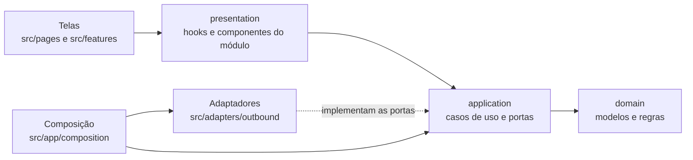
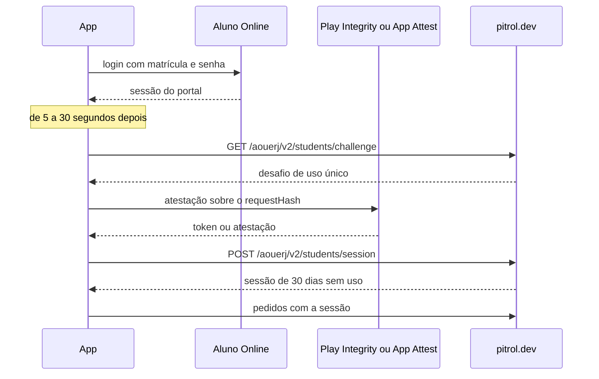

# Arquitetura

O app segue portas e adaptadores: os casos de uso dependem de portas (interfaces). Protocolos, HTML e bibliotecas de fornecedores ficam nos adaptadores, e a composição conecta as implementações.

## Camadas

Cada módulo de `src/modules/<nome>/` tem até três pastas:

- **`domain/`:** modelos e regras puras (a conta da PF, o plano até a formatura, a validação do aviso remoto). Não conhece React, rede nem armazenamento.
- **`application/`:** os casos de uso e as portas de que eles precisam (o portal, o cofre, o servidor).
- **`presentation/`:** hooks, provedores e textos que as telas usam.

## Mapa de pastas

| Pasta                                       | O que tem                                                                                                                                                                                                                   |
| ------------------------------------------- | --------------------------------------------------------------------------------------------------------------------------------------------------------------------------------------------------------------------------- |
| `src/app/`                                  | Composição (`composition/`), provedores, QueryClient e splash nativo (`splash.ts`)                                                                                                                                          |
| `src/app/background/`                       | Tarefa sem tela das verificações (WorkManager no Android, `BGTaskScheduler` no iPhone): os avisos do portal (`check`), "Avisar quando voltar" (`return`), a Companhia agora (`companion`) e o Agora no campus (`campus`)    |
| `src/app/observability/`                    | Registro de falhas no Sentry, desligado sem DSN; ver [Observabilidade](observabilidade.md)                                                                                                                                  |
| `src/app/dev/`                              | Deep links de debug (`aouerj-dev://`); ver [scripts/dev/README.md](../scripts/dev/README.md)                                                                                                                                |
| `src/modules/`                              | Os módulos, um por assunto (tabela abaixo)                                                                                                                                                                                  |
| `src/adapters/outbound/`                    | `aluno-online` (o portal), `private-api` (o servidor próprio), `schedule-generator`, `delivery` (aviso remoto e lojas), `persistence` (armazenamento), `native` (recursos nativos) e `campus-map` (o atlas do mapa offline) |
| `src/specs/`                                | Specs do codegen para os TurboModules locais: In-App Updates, avisos, widget, cofre, Play Integrity e App Attest                                                                                                            |
| `src/pages/`                                | Uma pasta por tela do menu                                                                                                                                                                                                  |
| `src/features/`                             | Componentes de apresentação usados pelas telas (quadro de notas, folhas, blocos do Início)                                                                                                                                  |
| `src/components/ui/`                        | O design system "Agenda limpa"; ver [o README dele](../src/components/ui/README.md)                                                                                                                                         |
| `src/components/templates/`                 | Cabeçalho, painel das telas e menu lateral                                                                                                                                                                                  |
| `src/themes/`                               | Tokens e os temas claro e escuro                                                                                                                                                                                            |
| `src/shared/`                               | Erros compartilhados (`AppError`)                                                                                                                                                                                           |
| `src/hooks/`, `src/utils/`, `src/services/` | Hooks de tela, formatação e constantes, navegação fora dos componentes (`rootNavigation`)                                                                                                                                   |
| `android/`, `ios/`                          | Os projetos nativos, com os módulos próprios (cofre, avisos, widget, atalhos)                                                                                                                                               |
| `server/`                                   | O backend próprio; ver [server/README.md](../server/README.md)                                                                                                                                                              |

### Módulos

| Módulo          | Assunto                                                                                                                                       |
| --------------- | --------------------------------------------------------------------------------------------------------------------------------------------- |
| `identity`      | Identidade pública, login, restauração e logout                                                                                               |
| `academics`     | Modelos, regras acadêmicas (PF, CR, progresso), consultas e compartilhamento                                                                  |
| `attendance`    | Faltas marcadas pelo aluno, só no aparelho                                                                                                    |
| `evaluations`   | Provas e trabalhos anotados pelo aluno, só no aparelho                                                                                        |
| `graduation`    | Plano até a formatura (pré-requisitos, carga e prazo)                                                                                         |
| `planning`      | Preparação e geração de grades                                                                                                                |
| `documents`     | Emissão de documentos; ver [Emissão de documentos](emissao-de-documentos.md)                                                                  |
| `home`          | O Início configurável ("Personalizar o Início")                                                                                               |
| `community`     | Mensagens do mural e consulta de professores                                                                                                  |
| `companion`     | Companhia agora                                                                                                                               |
| `campus-now`    | Agora no campus                                                                                                                               |
| `campus-map`    | O mapa offline do campus                                                                                                                      |
| `trust`         | A sessão de aluno no servidor próprio (`StudentSession`)                                                                                      |
| `connectivity`  | Internet e situação do portal (fora do ar, lento, de volta)                                                                                   |
| `notifications` | Lembretes de aula e de avaliações e avisos do portal (nota, RID, inscrição, documento), da volta do portal, da Companhia e do Agora no campus |
| `widget`        | Widgets "Próxima aula" e "Hoje" da tela inicial                                                                                               |
| `launch`        | Aberturas de fora do app (aviso, atalho do ícone, widget)                                                                                     |
| `delivery`      | Aviso remoto, atualização pela loja, a atualização OTA em uso e pedido de avaliação                                                           |
| `appearance`    | Tema do app (Sistema, Claro ou Escuro)                                                                                                        |
| `support`       | Relatórios estruturados e sanitização                                                                                                         |

## Fronteiras que o Oxlint guarda

- **Domínio e aplicação** (`src/modules/**/domain/**/*.ts` e `application/**/*.ts`) não importam React, React Native, React Navigation, styled-components, TanStack Query, Redux, axios nem cheerio, nem as pastas `adapters`, `app`, `presentation`, `services`, `features` e `store`: "Domínio e aplicação dependem de portas; conecte implementações na composição."
- **Em todo o `src/`:** nada da raiz do `cheerio` (quebra no Metro; use `loadHtml()` de `src/adapters/outbound/aluno-online/html.ts`, com `cheerio/slim` e parse5), nada de `react-native-cheerio` e nada de `react-native-toast-message` direto (use a fachada `snackbar` de `@components/ui`).
- **`src/modules/**` e `src/app/**`:** `react/exhaustive-deps` como erro.
- **No servidor:** as regras hexagonais de [server/README.md](../server/README.md#arquitetura).

O `scripts/__tests__/architecture.test.cjs` (no `pnpm test:tooling`) confere que essas regras continuam valendo.

## Composição

`src/app/composition/createAppServices.ts` monta os serviços do app: liga cada porta a um adaptador (o portal, o cofre, o servidor, os módulos nativos) e entrega tudo às telas pelo `AppServicesProvider`. É o único lugar que conhece os dois lados. Os módulos que dependem de recursos de uma plataforma (a sessão de aluno, a Companhia agora, o Agora no campus, os avisos) dizem se estão disponíveis, e o menu esconde o que não está.

## Atualizações OTA

O JavaScript pode mudar sem a loja: o `expo-updates` (Expo SDK 58, com os módulos do Expo num React Native sem o resto do Expo) busca no servidor próprio, a cada abertura a frio, uma atualização para o runtime version da build. Como publicar, voltar atrás e o que pode ir por OTA está em [Atualizações OTA](ota.md); aqui ficam os pontos de integração.

- **Na abertura:** a busca não segura o app (`checkOnLaunch` `ALWAYS`, espera 0). Ele abre com o JS que já tem (o da instalação ou o último baixado), e a atualização nova vale na abertura seguinte. Uma atualização que derruba o app antes da primeira tela volta sozinha ao JS anterior (a recuperação de erros do `expo-updates`). No debug, o `expo-updates` fica desligado e o JS vem do Metro.
- **Assinatura:** todo manifesto vem assinado (`rsa-v1_5-sha256`, keyid `main`). O certificado público é o `config/ota/certificate.pem`: o Gradle o lê no build, e o `Expo.plist` do iPhone leva uma cópia, conferida pelo `pnpm test:tooling`. A chave privada nunca entra no repositório.
- **Runtime version:** a impressão digital do lado nativo (política `fingerprint` no `app.json`, pelo `@expo/fingerprint`). O build a calcula e a grava no app (`file:fingerprint`), e `node scripts/ota/runtime-version.cjs <android|ios>` dá o mesmo valor, porque roda o mesmo passo do build. Entram `android/` ou `ios/`, as versões dos módulos nativos e do React Native, os `patches/`, as specs do codegen (`src/specs` e o `codegenConfig`) e o certificado. Ficam de fora o JS, os arquivos locais fora do Git e os CR do Git para Windows (`fingerprint.config.js`). No Android, a tarefa do `expo-updates` que grava o valor roda em todo build (`app/build.gradle`): ela não declara os arquivos do hash, e o Gradle a pularia num build incremental. O `scripts/__tests__/ota-runtime.test.cjs` guarda esse contrato.
- **Imagens:** o `metro.config.js` usa o `hashAssetFiles` do `expo-asset`, como o `expo/metro-config`. Sem o hash, o manifesto embutido e o `expo export` deixam as imagens de fora.
- **Android:** a `MainApplication` usa o host do Expo (`ExpoReactHostFactory`, com os pacotes locais) e o `ApplicationLifecycleDispatcher`. A `MainActivity` usa o `ReactActivityDelegateWrapper`, que só carrega o JS depois de o `expo-updates` escolher o pacote, fora da thread principal. A tarefa sem tela (`PortalCheckWorker`) abre o mesmo host e roda o mesmo pacote. A configuração fica no `AndroidManifest.xml`, com o endereço e o liga/desliga (só o release) vindos do `app/build.gradle`.
- **iPhone:** o início próprio, com e sem janela, está em [iOS](ios.md#atualizações-ota).
- **No JS:** a tela Sobre mostra o dia da atualização em uso ao lado da versão ("Versão 2.16.0 · atualização de 06/11"), só quando não é o JS da instalação. O `expo-updates` é lido pelo adaptador `src/adapters/outbound/delivery/runningUpdate.ts` (o `runningUpdate` da entrega, em `useRunningUpdate`). Nos testes do Jest, o `jest/setup-expo-updates.js` simula o JS da instalação.

## Aluno Online

O app lê o portal real com a conta do aluno, como um navegador faria.

- **Coordenador:** o adaptador do Aluno Online (`src/adapters/outbound/aluno-online/createAlunoOnlineAdapter.ts`) centraliza login, token, códigos de requisição e renovação concorrente. Uma consulta expirada permite um único replay. Um `POST` nunca é repetido sozinho: uma resposta perdida pode já ter mudado o portal.
- **Parsers:** um por página, em `parsers/`. Eles diferenciam página vazia reconhecida de estrutura inesperada (`PORTAL_LAYOUT_CHANGED`). Os testes usam páginas sintéticas, em `__fixtures__/`.
- **Queries:** as consultas acadêmicas usam a conta e o contexto do portal na chave (`academicKeys`, em `src/modules/academics/presentation/queryKeys.ts`). Cookies e tokens não participam das chaves. Os erros transitórios têm repetição limitada (uma nova tentativa). Os componentes não copiam respostas para outro armazenamento de estado.
- **Cache:** o que fica guardado e por quanto tempo está em [Dados e armazenamento](dados-e-armazenamento.md).

Alterações no portal podem exigir a atualização dos parsers. O app preserva os dados já carregados e informa as falhas de atualização; o relato em "Sobre" serve para descrever problemas persistentes.

## Gerador de grades, mural e suporte

Mensagens, suporte, situação do portal e geração de grades usam APIs próprias, distintas do portal da UERJ: `https://pitrol.dev/aouerj` (`src/adapters/outbound/private-api`) e `https://pitrol.dev/schedules` (`src/adapters/outbound/schedule-generator`).

O gerador tem três passos (disciplinas, horários e grades). Cada disciplina marcada tem a própria consulta dos detalhes (`useSubjectDetailsList`, no máximo três leituras do portal de cada vez), e a tela das grades envia a solicitação ao chegar e a cada ajuste, com as folhas fechadas. O horário de almoço é uma regra do pedido (`lunch_break`): o servidor só devolve grades que deixam um trecho livre na janela, em cada dia com aula.

## Servidor próprio (`server/`)

O backend de `https://pitrol.dev` fica em [`server/`](../server/README.md): em `/aouerj`, o mural, os docentes, os relatos de erro, as sugestões dos apps antigos, a situação do Aluno Online e, na v2, a sessão de aluno, a Companhia agora e o Agora no campus; em `/schedules`, o gerador de grades.

- **Hexagonal, com os nomes do app:** TypeScript rodado direto pelo Node 22.18+. Cada módulo tem domínio, portas e casos de uso sem framework; os adaptadores de entrada (HTTP, agendador) e de saída (MongoDB, arquivos, portal, atestação, threads) ficam nas bordas e só se encontram na raiz de composição. O gerador busca numa thread à parte, com fila e limite de tempo, e dá as mesmas grades que o serviço antigo.
- **Contrato:** os corpos e as respostas da API são tipos em `server/src/adapters/inbound/http/contract.ts`, que os adaptadores do app (`src/adapters/outbound/private-api` e `schedule-generator`) importam. Um campo trocado de um lado não passa no `pnpm type-check` (o `tsconfig.contract.json` cobre o teste de contrato).
- **Teste de contrato:** `src/adapters/outbound/__tests__/server.contract.test.ts` sobe o servidor de verdade (`server/test/fixtures/contractServer.ts`, com os repositórios em memória) e roda os adaptadores do app, com o mesmo cliente axios, contra ele: a situação do portal, o mural, os docentes, o relato de erro, o gerador, a Companhia agora e o Agora no campus, estes dois com dois alunos e a atestação de desenvolvimento. Ele roda no `pnpm test:ci` e antes de cada implantação.
- **Pacote à parte:** o servidor tem dependências e lockfile próprios, fora do workspace do app. O `postinstall` da raiz o instala; `pnpm server dev` sobe e `pnpm test:server` testa (alguns testes sobem um mongod próprio).
- Lint, formatação e tipos da raiz cobrem o servidor, e o CI roda os testes dele no mesmo job do app.

### Sessão de aluno

O mural, a busca de docentes, a Companhia agora, o Agora no campus e o relato de erro falam com `/aouerj/v2` como o aluno identificado. O lado do servidor está em [server/README.md](../server/README.md#identificação-do-aluno-v2); o que é enviado e guardado, em [Dados e armazenamento](dados-e-armazenamento.md#identificação-do-aluno).

- **No app:** `src/modules/trust` (`StudentSession`) e os módulos nativos `DeviceTrust` (Play Integrity, SHA-256 e SecureRandom do Android) e `AppAttest` (App Attest, CommonCrypto e `SecRandomCopyBytes` do iPhone). O `createDeviceTrust` (`src/app/composition/createStudentSession.ts`) escolhe pela plataforma.
- **Projeto do Google Cloud:** o número do projeto ligado ao app (`ao-uerj`, 377368074507) fica em `src/adapters/outbound/native/NativeDeviceTrust.ts`. Vazio, o app não entra.
- **No iPhone:** cada entrada gera uma chave nova do App Attest e a atesta com os 32 bytes do `requestHash` (o hex decodificado) como `clientDataHash`. O pedido leva `appAttest` (`keyId` e `attestation`, em base64 padrão) no lugar do `integrityToken`.
- **Recusas:** as esperas depois de uma recusa (`RETRY_AFTER_MS`) são as mesmas nas duas plataformas.
- **Pedidos:** os pedidos da `private-api` passam por `createSessionClient`, que manda a sessão, entra de novo uma vez num 401 e transforma o banimento em `STUDENT_BANNED`. O gerador de grades usa a sessão quando há, sem exigir: sem ela (simulador, sem rede para a atestação), gera como os apps antigos; com a sessão vencida, a esquece e gera sem ela; banido, não gera.
- **Apps antigos:** os tokens anônimos dos apps de 2.11.1 a 2.13 continuam só no servidor.
