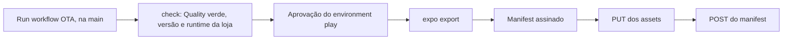

# Atualizações OTA

Como sai uma correção do JavaScript sem passar pela loja, para quem mantém o projeto. O app usa o `expo-updates` (do Expo SDK 58, num React Native sem o resto do Expo): ao abrir, pergunta ao servidor de `pitrol.dev` se há um update para a build instalada. Não há EAS nem servidores da Expo no caminho, e todo update vai assinado; o app recusa o que não tiver a assinatura (ver a [política de privacidade](privacidade.md)).



## O que vai por OTA

**Vai:**

- o código de `src/`: telas, textos, regras, os parsers do Aluno Online;
- as imagens e os outros arquivos que o JS importa (`require`);
- uma dependência só de JavaScript.

**Não vai** (pede uma [release](release.md) na loja):

- qualquer mudança em `android/` ou `ios/`;
- uma dependência com código nativo, nova ou atualizada (o autolinking muda a build);
- os módulos nativos do app (`src/specs` e o codegen), o widget e o segundo plano;
- permissões, ícone, splash, o nome do app e o que mais fica na configuração nativa;
- React Native, Hermes, Expo e `expo-updates`;
- o certificado de assinatura (ver [Chave e certificado](#chave-e-certificado));
- a versão do app (ver [Um OTA não é bump](#um-ota-não-é-bump)).

Quem decide é o runtime version: se ele mudou, o nativo mudou, e o OTA é recusado.

## A regra de compatibilidade

- Cada build da loja embute um runtime version, o que `node scripts/ota/runtime-version.cjs <android|ios>` imprime para aquele código. O app só aceita updates do runtime dele.
- Depois que a Play aceita o AAB, o job `runtime-version` do [Release](../.github/workflows/release.yml) grava esse valor no GitHub Release da versão, como o asset `runtime-version-android.txt`. Uma versão sem esse asset não conta como build na loja.
- O workflow OTA acha a última build de cada plataforma na loja (o GitHub Release `vX.Y.Z` mais novo com o asset) e só publica se este commit tiver o mesmo runtime e a mesma versão no `package.json`.
- Um update vai para um runtime só. Quem está numa build mais antiga, de outro runtime, continua com o JS que veio na loja.
- **iPhone:** o iOS ainda não está na App Store (ver [iOS](ios.md)), então nenhuma release tem `runtime-version-ios.txt`, e o OTA de `ios` (ou `both`) é recusado. Quando uma build sair na App Store, grave o runtime à mão, no commit da tag: `node scripts/ota/runtime-version.cjs ios > runtime-version-ios.txt` e `gh release upload vX.Y.Z runtime-version-ios.txt`.

## Um OTA não é bump

Um OTA não muda a versão: nada de `package.json`, tag, `CHANGELOG.md`, GitHub Release ou Play. Uma versão nova é sempre uma release na loja (bump = release, ver [Release](release.md)).

O JS lê a versão do `package.json`: ela aparece no Sobre, vai nos relatos de erro e é a que o `minSupportedVersion` do [aviso remoto](aviso-remoto.md#minsupportedversion) compara. Um OTA com outra versão faria uma build da loja se passar por uma versão que ela não é. Por isso a conferência recusa um commit cuja versão não seja a da última build na loja: com um bump na `main` ainda fora da loja, publique a release primeiro.

## Publicar

1. Confira que o commit está na `main` e que o [Quality](../.github/workflows/quality.yml) dele passou.
2. Em Actions > OTA > Run workflow, selecione `main`, a plataforma e uma frase sobre o que muda. O mesmo pode ser feito com:

   ```sh
   gh workflow run ota.yml --ref main -f platform=android -f message="Lê a nova página de horários do portal"
   ```

3. O job `check`, sem segredos, confere que o run é da `main`, que o Quality passou neste commit (de um push ou de um run manual na `main`) e que a versão e o runtime são os da última build na loja. Uma recusa diz o motivo e o que fazer.
4. O job `publish` espera a aprovação do environment `play`.
5. Aprovado, ele roda o `expo export`, monta o manifest, assina e envia os assets e, só depois, o manifest. O resumo do run mostra o id do update de cada plataforma.

Um OTA de cada vez: um segundo run espera o primeiro terminar.

## Voltar ao JS da loja

Para desfazer um update ruim, rode o workflow com `rollback` marcado. Ele publica a diretiva `rollBackToEmbedded`, assinada, para o runtime da última build na loja: os aparelhos voltam ao JS que veio na build. A volta não exige o Quality nem o runtime deste commit, então funciona mesmo com uma mudança nativa na `main` esperando a loja.

O próximo update publicado vale de novo (a diretiva leva a hora em que foi criada, e o update é mais novo que ela). O caminho normal é corrigir na `main` e publicar outro OTA.

Para outro runtime, que não é o da última build na loja, rode o publicador com a chave na sua máquina:

```sh
node scripts/ota/publish.cjs --platform android --rollback --runtime-version <runtime> --key-file <chave.pem>
```

## Conferir

**Antes de publicar.** O dry-run faz tudo menos o envio:

```sh
node scripts/ota/publish.cjs --platform android --dry-run --out-dir <pasta vazia>
```

A pasta fica com o `export-android/` do `expo export`, o `android/manifest.json` (o texto exato que o app recebe) com a assinatura em `android/manifest.sig`, e o `requests.json` com cada requisição na ordem do envio. Sem chave, a assinatura é de uma chave descartável, com a pública em `ephemeral-public-key.pem`, que nenhum aparelho aceita. Um export sem nenhum asset quer dizer que o `metro.config.js` não estende o `expo/metro-config`: sem o `hashAssetFiles` dele, as imagens ficam fora do update.

**Num servidor local.** Com o servidor rodando na sua máquina, use `--base-url http://localhost:<porta>` e `--key-file` com uma chave de teste (só `localhost` aceita `http`). Os endereços dos assets no manifest também apontam para `localhost`; no emulador, `adb reverse tcp:<porta> tcp:<porta>` faz esse endereço chegar à sua máquina. O app precisa ser uma build de QA, que procura updates nesse servidor (`-PotaUpdateUrl`, em `android/app/build.gradle`) e embute o certificado da chave de teste: troque o `config/ota/certificate.pem` só na sua cópia, sem commit, e passe o mesmo certificado em `--certificate`. O Android lê esse arquivo no build; o iOS leva uma cópia no `ios/AOUerjMobile/Expo.plist`, conferida pelo `pnpm test:tooling`, que falha enquanto a sua cópia estiver trocada.

**No aparelho.** Com a build da loja instalada (o teste interno vale), abra o app, espere uns segundos, feche e abra de novo: na configuração padrão do `expo-updates`, o update baixado numa abertura vale na seguinte. Confira a mudança na tela. A volta ao JS da loja é conferida do mesmo jeito.

## Chave e certificado

A assinatura é `rsa-v1_5-sha256`, com o keyid `main`. A chave privada é o secret `OTA_SIGNING_KEY` do environment `play`, com o texto PEM. Ela nunca vai para o repositório nem para o log, e o publicador a tira do ambiente do `expo export` (nenhum plugin do Babel consegue embuti-la no bundle) e confere que nenhum arquivo enviado a contém. O certificado, que é público, fica em `config/ota/certificate.pem`: o build do Android o embute no app, e o servidor confere os envios com ele.

Antes de qualquer envio, o publicador confere a chave contra esse certificado (ou contra o de `--certificate`): uma chave errada faria todo aparelho recusar o update, sem aviso.

Para gerar um par, fora do repositório:

```sh
npx expo-updates codesigning:generate --key-output-directory <fora do repo> \
  --certificate-output-directory <fora do repo> \
  --certificate-validity-duration-years 10 --certificate-common-name "AO UERJ"
gh secret set OTA_SIGNING_KEY --env play < <fora do repo>/private-key.pem
```

**Troca da chave.** O certificado faz parte da build nativa, então um certificado novo é uma release na loja:

1. Gere o par novo.
2. Ponha o certificado novo em `config/ota/certificate.pem` e no servidor e publique a release na loja.
3. Com a build nova na loja, troque o secret `OTA_SIGNING_KEY`.

Entre o passo 2 e o 3, o OTA é recusado: a chave do secret não é a do certificado do repositório. Os OTAs seguintes vão para a build nova. As builds antigas aceitam só a chave antiga e ficam com o que têm até a pessoa atualizar pela loja.

**Se a chave vazar.** O servidor aceita um envio só pela assinatura: troque nele o certificado na hora, para ele parar de aceitar a chave vazada, e faça a troca acima.

## O publicador

O [`scripts/ota/publish.cjs`](../scripts/ota/publish.cjs) roda só com o Node, sem dependências além do `expo` do app. Ele exporta e assina tudo antes do primeiro envio; um update nunca aponta para um asset que o servidor não tem. `--help` lista as opções.

| Requisição                      | Corpo                                                                       | Assinatura                                   |
| ------------------------------- | --------------------------------------------------------------------------- | -------------------------------------------- |
| `PUT /aouerj/ota/assets/<hash>` | O arquivo, com o `content-type` dele                                        | Cabeçalho `expo-ota-signature`, sobre o hash |
| `POST /aouerj/ota/updates`      | `{ platform, runtimeVersion, manifest, signature }`, o manifest como texto  | Sobre o texto exato do manifest              |
| `POST /aouerj/ota/directives`   | `{ platform, runtimeVersion, directive, signature }`, a diretiva como texto | Sobre o texto exato da diretiva              |

O `hash` é o SHA-256 do arquivo em base64url sem `=`, e a `key` de cada asset é o MD5 dele, como no [servidor de exemplo da Expo](https://github.com/expo/custom-expo-updates-server). O manifest segue o [protocolo Expo Updates v1](https://docs.expo.dev/technical-specs/expo-updates-1/), com os assets servidos em `https://pitrol.dev/aouerj/ota/assets/<hash>`. Os PUTs, que são idempotentes, repetem em falha de rede, 429 e 5xx; os POSTs não, para não publicar duas vezes.

As conferências do workflow ficam em [`scripts/ci/ota-check.cjs`](../scripts/ci/ota-check.cjs), e os testes dos dois, em `pnpm test:tooling`.

Os source maps de um OTA não vão para o Sentry, que está desligado (ver [Observabilidade](observabilidade.md#source-maps-e-símbolos)). Quando ele for ligado, cada OTA vai precisar dos seus, porque o release do Sentry é o da build nativa.
