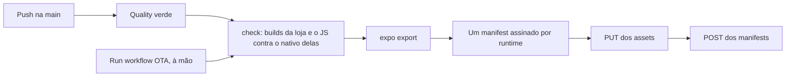

# Atualizações OTA

Como sai uma correção do JavaScript sem passar pela loja, para quem mantém o projeto. O app usa o `expo-updates` (do Expo SDK 58, num React Native sem o resto do Expo): ao abrir, pergunta ao servidor de `pitrol.dev` se há um update para a build instalada. Não há EAS nem servidores da Expo no caminho, e todo update vai assinado; o app recusa o que não tiver a assinatura (ver a [política de privacidade](privacidade.md)).



Todo push na `main` com JavaScript novo sai por OTA, sem ninguém pedir: depois do [Quality](../.github/workflows/quality.yml) verde do push, o workflow OTA roda sozinho e publica para as builds que estão nas lojas, inclusive as de outro nativo, quando o JS roda nelas (ver [OTA para uma build de outro runtime](#ota-para-uma-build-de-outro-runtime)). Um push que só mexe em `server/`, `docs/`, nos workflows, nos scripts ou no nativo não publica nada.

## O que vai por OTA

**Vai:**

- o código de `src/`: telas, textos, regras, os parsers do Aluno Online;
- as imagens e os outros arquivos que o JS importa (`require`);
- uma dependência só de JavaScript.

**Não vai** (pede uma [release](release.md) na loja):

- qualquer mudança em `android/` ou `ios/`;
- uma dependência com código nativo, nova ou atualizada (o autolinking muda a build);
- os módulos nativos do app (`src/specs` e o codegen), o widget e o segundo plano;
- permissões, ícone, splash, o nome do app e o que mais fica na configuração nativa;
- React Native, Hermes, Expo e `expo-updates`;
- o certificado de assinatura (ver [Chave e certificado](#chave-e-certificado)).

O runtime version marca o nativo: o app só aceita updates do runtime dele. A versão do app (o bump) não entra nele, nem no iPhone: as linhas `MARKETING_VERSION` e `CURRENT_PROJECT_VERSION` do `project.pbxproj` ficam fora do cálculo (`fingerprint.config.js`).

## A regra de compatibilidade

- Cada build da loja embute um runtime version, o que `node scripts/ota/runtime-version.cjs <android|ios>` imprime para aquele código.
- O [Release](../.github/workflows/release.yml) grava esse valor no GitHub Release da versão quando a loja recebe a build: o `runtime-version-android.txt` depois que a Play aceita o AAB (teste interno) e o `runtime-version-ios.txt` depois que o IPA chega ao App Store Connect. Uma versão sem o asset não conta como build na loja.
- O workflow OTA lê o runtime de cada build na loja (os GitHub Releases `vX.Y.Z` com o asset) e publica o JS deste commit para os três runtimes mais novos de cada plataforma: o da build mais nova (que talvez ainda esteja no teste interno ou na revisão da Apple) e os anteriores, que estão nos aparelhos de quem ainda não atualizou. O resumo do `check` diz quais builds recebem e quais ficam de fora, e por quê.
- Um runtime cuja build mais nova já tem este mesmo JS fica de fora.
- As builds do iPhone até a 2.18.0 (build 28) ainda contavam a versão no runtime, e os runtimes delas não estão registrados.

## OTA para uma build de outro runtime

Quando a `main` tem nativo novo, que ainda não está na loja, o JS dela ainda pode ir para as builds antigas, se rodar no nativo delas. O `check` compara a tag de cada build com este commit (`scripts/ci/ota-compat.cjs`) e só publica se nada do que o JS chama mudou:

- **Métodos dos módulos nativos do app** (`src/specs`): um método que sumiu ou mudou de assinatura barra. Um método novo só passa se o JS conferir que ele existe antes de chamar, com `typeof modulo.metodo === 'function'` fora dos testes; sem ele, a build antiga ganharia um erro na chamada. Um módulo novo precisa ser lido com `TurboModuleRegistry.get` (que dá `null` sem ele), não com `getEnforcing`.
- **Dependências com código nativo**, novas ou de outra versão, e o `codegenConfig` do `package.json`.
- **O certificado das atualizações** e o `app.json` (fora a versão).

O resto do nativo (`android/`, `ios/`, os patches de dependências, o manifesto, ícones) muda a build, não o que o JS chama, e não barra. Para conferir na sua máquina: `node scripts/ci/ota-compat.cjs v2.19.0`.

O publicador só aceita um runtime diferente do deste código com `--other-runtime`, que o workflow passa depois dessa conferência. O JS publicado assim mostra a versão do `package.json` da `main` no Sobre, com o nativo da build antiga.

## OTA e bump

Um OTA não faz bump: nada de tag, `CHANGELOG.md`, GitHub Release ou loja. E um bump não barra um OTA: só o nativo barra. Depois de um bump só de JS (a `main` na 2.18.1, a loja na 2.18.0 com o mesmo runtime), o OTA da `main` chega à 2.18.0.

O JS lê a versão do `package.json`, que é a do código que roda: com esse OTA, a build 2.18.0 mostra no Sobre "Versão 2.18.1 · atualização de dd/mm", manda `appVersion` 2.18.1 nos relatos (com o `updateId`, que diz que é um OTA) e compara 2.18.1 com o `minSupportedVersion` do [aviso remoto](aviso-remoto.md#minsupportedversion). Isso descreve o app de verdade: o mesmo runtime é o mesmo nativo, e só o JS mudou. Quem tem uma build de outro runtime (nativo diferente) não recebe o update e continua com a versão dela, então a versão mínima ainda prende quem precisa da loja.

## Publicar

**Sozinho.** Depois do Quality verde de um push na `main`, o workflow OTA roda com as duas plataformas e o título do commit como mensagem. O `check` não publica nada (e não falha) quando:

- outro push já está na `main` (o OTA sai depois do Quality dele);
- o push só mexeu no que não entra no app (`server/`, `docs/`, `.github/`, `scripts/`, `android/`, `ios/`, testes e Markdown);
- nenhuma build da loja pode receber este JS; o resumo do run diz por quê.

**À mão**, para escolher a plataforma ou repetir:

1. Confira que o commit está na `main` e que o [Quality](../.github/workflows/quality.yml) dele passou.
2. Em Actions > OTA > Run workflow, selecione `main`, a plataforma e uma frase sobre o que muda. O mesmo pode ser feito com:

   ```sh
   gh workflow run ota.yml --ref main -f platform=android -f message="Lê a nova página de horários do portal"
   ```

3. O job `check`, sem segredos, confere que o run é da `main`, que o Quality passou neste commit (de um push ou de um run manual na `main`) e para quais builds da loja o JS pode ir, e diz quais recebem. À mão, sem nenhuma, ele falha com o motivo.
4. O job `publish`, no environment `play`, roda o `expo export` uma vez por plataforma, monta um manifest para cada runtime, assina e envia os assets e, só depois, os manifests. O resumo do run mostra o id de cada update.

Um OTA de cada vez: um segundo run espera o primeiro terminar.

## Voltar ao JS da loja

Para desfazer um update ruim, rode o workflow com `rollback` marcado. Ele publica a diretiva `rollBackToEmbedded`, assinada, para o runtime da última build na loja: os aparelhos voltam ao JS que veio na build. A volta não exige o Quality nem o runtime deste commit, então funciona mesmo com uma mudança nativa na `main` esperando a loja.

O próximo update publicado vale de novo (a diretiva leva a hora em que foi criada, e o update é mais novo que ela). O caminho normal é corrigir na `main` e publicar outro OTA.

Para outro runtime, que não é o da última build na loja, rode o publicador com a chave na sua máquina:

```sh
node scripts/ota/publish.cjs --platform android --rollback --runtime-version <runtime> --key-file <chave.pem>
```

## Conferir

**Antes de publicar.** O dry-run faz tudo menos o envio:

```sh
node scripts/ota/publish.cjs --platform android --dry-run --out-dir <pasta vazia>
```

A pasta fica com o `export-android/` do `expo export`, o `android/manifest.json` (o texto exato que o app recebe) com a assinatura em `android/manifest.sig`, e o `requests.json` com cada requisição na ordem do envio. Sem chave, a assinatura é de uma chave descartável, com a pública em `ephemeral-public-key.pem`, que nenhum aparelho aceita. Um export sem nenhum asset quer dizer que o `metro.config.js` não estende o `expo/metro-config`: sem o `hashAssetFiles` dele, as imagens ficam fora do update.

**Num servidor local.** Com o servidor rodando na sua máquina, use `--base-url http://localhost:<porta>` e `--key-file` com uma chave de teste (só `localhost` aceita `http`). Os endereços dos assets no manifest também apontam para `localhost`; no emulador, `adb reverse tcp:<porta> tcp:<porta>` faz esse endereço chegar à sua máquina. O app precisa ser uma build de QA, que procura updates nesse servidor (`-PotaUpdateUrl`, em `android/app/build.gradle`) e embute o certificado da chave de teste: troque o `config/ota/certificate.pem` só na sua cópia, sem commit, e passe o mesmo certificado em `--certificate`. O Android lê esse arquivo no build; o iOS leva uma cópia no `ios/AOUerjMobile/Expo.plist`, conferida pelo `pnpm test:tooling`, que falha enquanto a sua cópia estiver trocada.

**No aparelho.** Com a build da loja instalada (o teste interno vale), abra o app, espere uns segundos, feche e abra de novo: na configuração padrão do `expo-updates`, o update baixado numa abertura vale na seguinte. Confira a mudança na tela. A volta ao JS da loja é conferida do mesmo jeito.

## Chave e certificado

A assinatura é `rsa-v1_5-sha256`, com o keyid `main`. A chave privada é o secret `OTA_SIGNING_KEY` do environment `play`, com o texto PEM. Ela nunca vai para o repositório nem para o log, e o publicador a tira do ambiente do `expo export` (nenhum plugin do Babel consegue embuti-la no bundle) e confere que nenhum arquivo enviado a contém. O certificado, que é público, fica em `config/ota/certificate.pem`: o build do Android o embute no app, e o servidor confere os envios com ele.

Antes de qualquer envio, o publicador confere a chave contra esse certificado (ou contra o de `--certificate`): uma chave errada faria todo aparelho recusar o update, sem aviso.

Para gerar um par, fora do repositório:

```sh
npx expo-updates codesigning:generate --key-output-directory <fora do repo> \
  --certificate-output-directory <fora do repo> \
  --certificate-validity-duration-years 10 --certificate-common-name "AO UERJ"
gh secret set OTA_SIGNING_KEY --env play < <fora do repo>/private-key.pem
```

**Troca da chave.** O certificado faz parte da build nativa, então um certificado novo é uma release na loja:

1. Gere o par novo.
2. Ponha o certificado novo em `config/ota/certificate.pem` e no servidor e publique a release na loja.
3. Com a build nova na loja, troque o secret `OTA_SIGNING_KEY`.

Entre o passo 2 e o 3, o OTA é recusado: a chave do secret não é a do certificado do repositório. Os OTAs seguintes vão para a build nova. As builds antigas aceitam só a chave antiga e ficam com o que têm até a pessoa atualizar pela loja.

**Se a chave vazar.** O servidor aceita um envio só pela assinatura: troque nele o certificado na hora, para ele parar de aceitar a chave vazada, e faça a troca acima.

## O publicador

O [`scripts/ota/publish.cjs`](../scripts/ota/publish.cjs) roda só com o Node, sem dependências além do `expo` do app. Ele exporta e assina tudo antes do primeiro envio; um update nunca aponta para um asset que o servidor não tem. `--help` lista as opções.

| Requisição                      | Corpo                                                                       | Assinatura                                   |
| ------------------------------- | --------------------------------------------------------------------------- | -------------------------------------------- |
| `PUT /aouerj/ota/assets/<hash>` | O arquivo, com o `content-type` dele                                        | Cabeçalho `expo-ota-signature`, sobre o hash |
| `POST /aouerj/ota/updates`      | `{ platform, runtimeVersion, manifest, signature }`, o manifest como texto  | Sobre o texto exato do manifest              |
| `POST /aouerj/ota/directives`   | `{ platform, runtimeVersion, directive, signature }`, a diretiva como texto | Sobre o texto exato da diretiva              |

O `hash` é o SHA-256 do arquivo em base64url sem `=`, e a `key` de cada asset é o MD5 dele, como no [servidor de exemplo da Expo](https://github.com/expo/custom-expo-updates-server). O manifest segue o [protocolo Expo Updates v1](https://docs.expo.dev/technical-specs/expo-updates-1/), com os assets servidos em `https://pitrol.dev/aouerj/ota/assets/<hash>`. Os PUTs, que são idempotentes, repetem em falha de rede, 429 e 5xx; os POSTs não, para não publicar duas vezes.

As conferências do workflow ficam em [`scripts/ci/ota-check.cjs`](../scripts/ci/ota-check.cjs), e os testes dos dois, em `pnpm test:tooling`.

Os source maps de um OTA não vão para o Sentry, que está desligado (ver [Observabilidade](observabilidade.md#source-maps-e-símbolos)). Quando ele for ligado, cada OTA vai precisar dos seus, porque o release do Sentry é o da build nativa.
