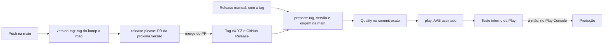

# Release

Como sai uma versão nova, para quem mantém o projeto. Para contribuir, você não precisa de nada daqui: o PR entra na `main`, e a versão sai depois.



## Versão

- **Android:** o `package.json` é a fonte. O Gradle deriva o `versionName` (`vX.Y.Z`) e o `versionCode` (`MAJOR × 10⁷ + MINOR × 10⁴ + PATCH`; a 1.3.6 é 10030006). A fórmula exige MAJOR a partir de 1, MINOR até 999 e PATCH até 9999, e o build falha fora disso.
- **iOS:** `MARKETING_VERSION` e `CURRENT_PROJECT_VERSION` ficam nas configurações do projeto no `project.pbxproj` (o app e o widget herdam) e são atualizados à mão antes da publicação. Ficam fora do release-please porque o Xcode reescreve esse arquivo.
- **Manifest:** o `.release-please-manifest.json` registra a última release e evita que o release-please proponha de novo uma versão já publicada.

## Commits e changelog

O release-please lê os prefixos dos commits (a convenção está no [guia de contribuição](../CONTRIBUTING.md#commits)) para escolher a próxima versão e montar o `CHANGELOG.md`. As seções ficam em `release-please-config.json`: `feat` vai para "Novidades", `fix` para "Correções", `perf` para "Desempenho" e `revert` para "Reversões". Os outros tipos (`refactor`, `docs`, `test`, `build`, `ci`, `style`, `chore`) não aparecem.

## Pelo PR do release-please

A cada push na `main`, o release-please (`release.yml`) mantém um PR "chore: release X.Y.Z" com a próxima versão no `package.json` e o `CHANGELOG.md`.

1. Esse PR não mexe no `project.pbxproj`: antes do merge, suba a versão do iOS num commit no próprio branch do PR.
2. O merge cria a tag `vX.Y.Z` e o GitHub Release.
3. O workflow confere a versão e a origem da tag na `main` (`scripts/ci/release-ref.cjs`), roda o Quality no commit exato e só então compila o AAB com a chave de upload, no environment `play`.
4. O envio é para o teste interno. A promoção para produção é feita no Play Console.

A criação do PR pelo `GITHUB_TOKEN` não dispara CI, mas o gate da publicação sempre executa os checks.

## Com um bump à mão

1. Faça o commit `chore: release X.Y.Z` com:
   - a versão no `package.json`;
   - a mesma versão no `.release-please-manifest.json`;
   - a entrada no `CHANGELOG.md`;
   - `MARKETING_VERSION` e `CURRENT_PROJECT_VERSION` (+1) no `project.pbxproj`.
2. Envie os commits das mudanças e o do bump num push só. Se as mudanças subirem antes, o release-please abre um PR propondo a próxima versão, e o bump não o fecha.
3. No push, o job `version-tag` (`scripts/ci/version-tag.cjs`) acha o commit do bump e, se a tag `vX.Y.Z` não existir, a cria anotada nesse commit, com a data dele. Ele nunca move uma tag, pula os merges do PR do release-please e não cria GitHub Release nem manda para a Play.
4. Para publicar, crie o GitHub Release (`gh release create vX.Y.Z --verify-tag`) e acione o workflow Release com a tag (abaixo).

Por que a tag importa: o release-please procura a versão do manifest como GitHub Release ou, sem ele, como a tag `vX.Y.Z`. Sem nenhum dos dois, volta ao `bootstrap-sha` e propõe uma 2.0.0 com o histórico inteiro.

## Publicar ou retomar uma publicação

Em Actions > Release > Run workflow, selecione `main` e informe a tag existente, por exemplo `v2.1.0`. O mesmo pode ser feito com:

```sh
gh workflow run release.yml --ref main -f tag=v2.1.0
```

- Isso repete os checks e o envio sem criar tag nem aumentar a versão.
- Para retomar, use quando a falha ocorreu antes de a Play aceitar o AAB. Se o `versionCode` já foi enviado, use o release existente no Console.
- Tags fora da `main` ou divergentes do `package.json` são recusadas.
- Secrets ausentes, JSON inválido e erros de keystore, alias ou senhas falham antes do build de publicação, sem expor valores.

O job `play` guarda no artefato do run o AAB, o `mapping.txt` e, quando existe, o `native-debug-symbols.zip`. Os símbolos nativos também vão dentro do AAB (`ndk.debugSymbolLevel`), onde a Play os lê.

## Configuração no GitHub

Habilite "Allow GitHub Actions to create and approve pull requests" e crie o environment `play`, com aprovação obrigatória e restrito à `main`, com os secrets:

- `ANDROID_KEYSTORE_BASE64`: a keystore de upload em base64 (`base64 -w0 upload.keystore`);
- `ANDROID_KEYSTORE_PASSWORD`, `ANDROID_KEY_ALIAS` e `ANDROID_KEY_PASSWORD`;
- `PLAY_SERVICE_ACCOUNT_JSON`: o JSON de uma conta de serviço do Google Cloud com a API Google Play Android Developer ativa e permissão de release no app (Play Console > Usuários e permissões);
- opcional: o secret `SENTRY_AUTH_TOKEN` e as variáveis `SENTRY_ORG` e `SENTRY_PROJECT`, para enviar os source maps à região UE. Sem o token, o envio é pulado (ver [Observabilidade](observabilidade.md#source-maps-e-símbolos)).

A implantação do servidor usa outro environment, o `production`; ver [server/README.md](../server/README.md#implantação).
